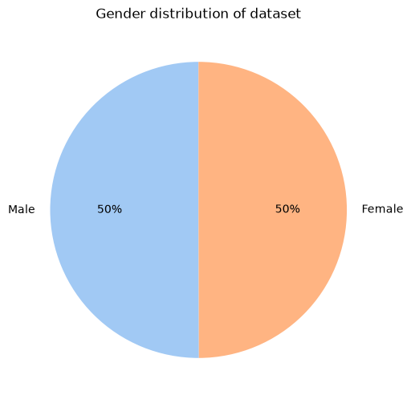
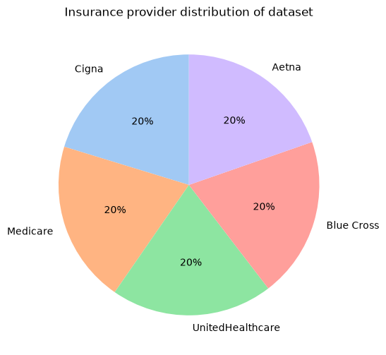

## Healthcare test results system

This repository hosts a multi-class machine learning system specifically engineered to analyze clinical data variables from the healthcare_dataset.csv directory and accurately predict explicit categorical outcomes (Normal, Abnormal, or Inconclusive).

Dataset: https://www.kaggle.com/datasets/prasad22/healthcare-dataset

---

## Business objective & strategic value

The primary goal of this predictive intelligence platform is to optimize clinical workflows, reduce operational overhead, and enhance medical validation accuracy. In the modern healthcare landscape, raw diagnostic volumes frequently outpace provider availability, creating systemic bottlenecks in patient care lifecycles.

### Key business driver alignment:

**Workflow triage automation:** By predicting whether incoming test results fall into Normal, Abnormal, or Inconclusive fields, hospital networks can build rule-based routing trees. This ensures that potentially high-risk, Abnormal records are prioritized instantly for rapid medical review.


**Administrative cost reduction:** Automated preprocessing safely flags and categorizes routine Normal cases. This significantly minimizes the manual classification overhead required of administrative staff and nurses, allowing them to shift focus to complex patient care.


**Minimizing diagnostic leakage:** Identifying Inconclusive cases early flags patients who require immediate scheduling for secondary laboratory screening or diagnostic re-runs before they depart the facility.


**Data-driven resource allocation:** Tracking geographic and localized feature shifts via the automated monitor_model drift dashboard empowers healthcare managers to align clinic staffing and inventory investments against rising Abnormal diagnostic trends.

---
## Project architecture & directory structure

```text
healthcare-ml/
│
├── api/
│   ├── controller/
│   │   ├── retrain.py          # Tracks automated data drift & retraining execution
│   │   └── sync_explain.py      # Stitches global/local SHAP visualizations
│   ├── database/
│   │   ├── database.py         # SQLite authentication management
│   │   └── schema.py           # Patient payload schema validations
│   ├── middleware/
│   │   ├── auth.py             # JWT bearer validation & worker rate-limiting
│   │   └── train.py            # Async application train hooks & context locking
│   └── api.py                  # Core ASGI FastAPI routing layer
│
├── data/
│   ├── raw/
│   │   └── healthcare_dataset.csv  # Base training records
│   ├── processed/
│   └── new/                    # Inference & live production data logs
│
├── models/
│   ├── models/                 # Saved machine learning estimator (.pkl) models
│   ├── pipelines/              # Serialized configuration pipelines
│   └── scalers/                # Extracted feature standardizers
│
├── src/
│   └── v1/
│       ├── config.py           # Tuning distributions & configuration attributes
│       ├── evaluate.py         # One-vs-Rest visual evaluation metrics engine
│       ├── explain.py          # Multiclass SHAP computation logic
│       ├── main.py             # Main pipeline orchestrator
│       ├── monitor.py          # Data drift and statistical calculation layer
│       └── preprocessing.py    # Feature engineering & target encoders
│
├── .gitignore                  # GIT ignore file
├── Dockerfile                  # containerization
├── README.MD                   # Project documentation
├── for_testing_model.json      # use this dataset for testing the model
├── pyproject.toml              # Project configuration profile
└── requirements.txt            # System dependencies manifest

```

---

## Feature engineering & correlation analysis

### Some important features and their implication
Not all feature are explained below for that, please consult the notebook/eda.ipynb. But features that has clear indication for test results are explained below.

**From the plots below it is pretty clear the admission type and other feature as well as test results itself is evenly distributed (keep that in mind while reading this).**

<table>
  <tr>
    <td></td>
    <td></td>
  </tr>
  <tr>
    <td></td>
    <td></td>
  </tr>
  <tr>
    <td></td>
    <td></td>
  </tr><tr>
    <td></td>
    <td></td>
  </tr>
</table>

### Now, for engineered features

* `admission_duration`: Difference of date of admission and dischage date.
* `admission_dayofmonth`: Measures the admission day of the month.
* `admission_month`: Measures the admission month.


#### Correlation matrix analysis


From the plot, it is pretty clear that the dataset is artificial and thus lacks correlation for high accuracy model. Not only that while playing with data i tried different models (more on that later). But, classification model (for test results) with Random Forest Classifier was the best, thus used for production.

#### Feature selection strategy

During the feature engineering phase, additional prospective features were generated—such as interaction terms combining subscription types, logarithmic usage transformations, and recency decay factors.

**Pruning Decisions:**
* **High-correlation (above 0.84)**
* **SHAP (SHapley Additive exPlanations) evaluation**
* **Elimination of Zero-Value features**

---

## Model evaluation

I trained both classification and regression model using the given dataset. But only `test_results` model could be trained with 60+ roc. Regression tasks weren't as accurate as i would like them to be so in production only it is trained. More comprehensively:

### Model in production - RandomForestClassifier

<table>
  <tr>
    <td></td>
    <td></td>
  </tr>
  <tr>
    <td></td>
  </tr>
</table>

I couldn't achieve any higher level of accuracy. If anyone randomly choose 1 class from 3, the percentage of selection one class over the other is 33.33%. So, the model in production technically is more accurate than randomness but not that high accurate. So, it puts into question if this model is suited for production or it should be scraped. In my opinion, this model should be used (if not scrapped) as simple direction not hard coded recommendation.

Since this model could only be used in the begining of the patient arrival (i.e. not to diagnose diseases), recall may not be that important.

All in all, everything seems to be pointing toward scraping this model (and dataset) alltogether.

### Other models (for classification)

I trained different models: XGBoost, LightGBM, and also Neural Network. Metrics are given below:

<table>
  <tr>
    <td></td>
    <td></td>
  </tr>
</table>

From the plot above, it should be clear why Random Forest Classifier was chosen for production. It is beating every other model in every metrics.

As for neural network, the reason why it is performing so badly could be that it is too shallow? or hyperparameter are too limiting? or simply dataset is bad for creating machine learning models.

### Other models (for regression)

I also trained different models for regression: XGBoost and LightGBM. Metrics are given below:

<table>
  <tr>
    <td></td>
  </tr>
</table>

Given dataset couldn't be used for regression. Sometimes, they perform even worse than selecting at random (i.e. r squared is negative). So, yeah, the dataset couldn't be used for regression.

---

## SHAP metrics for different models


Only those 4 features seem to be important enough for prediction (the most important one or the one that helps prediction the most is billing amount.). Which makes sense since the dataset was mostly encoded features (i.e. they are mostly 0s).

Which implies that those features could have been dropped but if those features were dropped we would only have those four set of features so i decided not to drop. **For production, well, this entire dataset is bad for machine learning modelling so getting better dataset should be priotised.**

---

## Quick start

### 1. Environment setup - Using requirements.txt

```bash
# Clone the repository
git clone https://github.com/officialroshanshahi/healthcare-ml.git
cd healthcare-ml

# Create and activate a Python virtual environment
python -m venv venv
source venv/bin/activate  # On Windows: venv\Scripts\activate

# Install dependencies
pip install -r requirements.txt

# Add .env to your root folder
Go to src/experiments and copy the .env. Make necessary changes and add that to your root project folder.
```

### 1.2 Environment setup - Using pyproject.toml

Users can choose between requirements.txt and pyproject.toml:

```bash
# Clone the repository
git clone https://github.com/officialroshanshahi/healthcare-ml.git
cd healthcare-ml

# Create and activate a Python virtual environment
python -m venv venv
source venv/bin/activate  # On Windows: venv\Scripts\activate

# Install the project and its dependencies using pyproject.toml
pip install .

# Add .env to your root folder
Go to src/experiments and copy the .env. Make necessary changes and add it to your root project folder.

```

### 2. Launch the FastAPI server

Launch the web interface for single-instance or batch test results prediction:

```bash
python -m api.uvicorn_init

```

### 3. Launch the Interactive Gradio Interface

Launch the web interface for single-instance or batch test results prediction:

```bash
python -m app.gradio.py

```
---

## Quick start - Lauching both api and gradio together side by side in VS code:

### 1. Go to src/experiments
### 2. Copy the tasks.json
### 3. Put that file in .vscode
### 4. Press CTRL + SHIFT + P
### 5. Click on Tasks: Run Task
### 6. Select Full-stack healthcare ML model

### Of course, make sure use your virtual environment, and install necessary modules first before doing this.
---

## Model lifecycle & MLOps practices

1. **Preprocessing (`src/v1/preprocessing.py`)**: Handles categorical encoding, missing value imputation, and feature engineering.


2. **Training & evaluation (`src/v1/train.py`, `src/v1/evaluate.py`)**: Executes cross-validation, evaluates metrics for data (Precision-Recall AUC, F1 Score), and serializes model artifacts.


3. **Explainability (`src/v1/explain.py`)**: Integrates SHAP summary plots and individual force plots to explain prediction drivers to business teams.


4. **Monitoring & Drift (`src/v1/monitor.py`)**: Tracks feature distributions between training baseline and incoming live inference streams to alert on data drift. When monitoring endpoint (/monitor) is run, it will create reports/reports_....html.


### Training (/health /predict /predict/batch) and retraining pipeline (/monitor) can be initialised through their respective endpoints.
